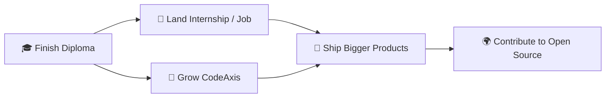

## Hi there 👋

<!--
**student-codingworld/student-codingworld** is a ✨ _special_ ✨ repository because its `README.md` (this file) appears on your GitHub profile.

Here are some ideas to get you started:

- 🔭 I’m currently working on ...
- 🌱 I’m currently learning ...
- 👯 I’m looking to collaborate on ...
- 🤔 I’m looking for help with ...
- 💬 Ask me about ...
- 📫 How to reach me: ...
- 😄 Pronouns: ...
- ⚡ Fun fact: ...
-->

<!-- ============================ HEADER ============================ -->
<div align="center">


<a href="https://github.com/student-codingworld">
  
</a>

<br/><br/>

[](https://meetme.rf.gd)
[](https://www.linkedin.com/in/pawan-patel-081721252/)
[](https://leetcode.com/u/techPawan/)
[](https://www.instagram.com/singhpawan7565/)


</div>

<!-- ============================ ABOUT ============================ -->

## 👨‍💻 About Me

<table>
<tr>
<td width="60%" valign="top">

I'm a **full-stack developer** and final-year computer science diploma student who loves turning ideas into working products. As **Founder & MD of CodeAxis**, I build software solutions and technology-driven projects, from blogging systems to AI-powered resume tools.

```js
const pawan = {
  role: "Full-Stack Developer",
  company: "CodeAxis (Founder & MD)",
  education: "Diploma in Computer Science (Final Year)",
  focus: ["Web Development", "AI-Powered Tools", "Problem Solving"],
  currentlyLearning: ["System Design", "Data Structures & Algorithms"],
  openTo: ["Internships", "Freelance", "Collaborations"],
  funFact: "I ship projects faster than I write bios ⚡"
};
```

</td>
<td width="40%" valign="top">

### ⚡ Quick Facts

- 🏢 Founder & MD, **CodeAxis**
- 🎓 Final-year CS diploma student
- 🧩 Practicing DSA on **LeetCode**
- 🌍 Based in **Uttar Pradesh, India**
- 💼 Open to **work & collaboration**
- 📫 Reach me via [Portfolio](https://meetme.rf.gd) or [LinkedIn](https://www.linkedin.com/in/pawan-patel-081721252/)

</td>
</tr>
</table>

<!-- ============================ TECH STACK ============================ -->

## 🛠️ Tech Stack

<div align="center">


</div>

<details>
<summary><b>🔍 See my skills in detail</b></summary>
<br/>

| Area | Technologies |
|---|---|
| **Frontend** | HTML5 • CSS3 • JavaScript |
| **Backend** | PHP • Python • Django |
| **Database** | MySQL |
| **Tools & Workflow** | Git • GitHub • VS Code • Linux |
| **Concepts** | REST APIs • Authentication & Security • Responsive Design • Data Structures & Algorithms |

</details>

<!-- ============================ PROJECTS ============================ -->

## 🚀 Featured Projects

<div align="center">

<a href="https://github.com/student-codingworld/blogPlatform">
  
</a>
<a href="https://github.com/student-codingworld/ats-checker">
  
</a>
<a href="https://github.com/student-codingworld/New_Portfolio">
  
</a>
<a href="https://github.com/student-codingworld/todo_app">
  
</a>

</div>

<br/>

| Project | What it does | Stack | Links |
|---|---|---|---|
| 📝 **blogPlatform** | Secure, customizable blogging system for developers, bloggers and students | `PHP` `MySQL` `JavaScript` | [Code](https://github.com/student-codingworld/blogPlatform) |
| 🧠 **ats-checker** | AI-powered ATS resume analyzer that matches resumes to job descriptions | `Python` `Django` | [Code](https://github.com/student-codingworld/ats-checker) |
| 🌐 **New_Portfolio** | Personal portfolio showcasing my journey and technical skills | `HTML` `CSS` `JavaScript` | [Code](https://github.com/student-codingworld/New_Portfolio) • [Live](https://pawancv.rf.gd) |
| ✅ **todo_app** | Clean task manager to organize daily work | `JavaScript` | [Code](https://github.com/student-codingworld/todo_app) |

<!-- ============================ STATS ============================ -->

## 📊 GitHub Analytics

<div align="center">


<br/>


<br/>


</div>

### 🐍 Contribution Snake

<div align="center">

<picture>
  <source media="(prefers-color-scheme: dark)" srcset="https://raw.githubusercontent.com/student-codingworld/student-codingworld/output/github-snake-dark.svg" />
  <source media="(prefers-color-scheme: light)" srcset="https://raw.githubusercontent.com/student-codingworld/student-codingworld/output/github-snake.svg" />
  
</picture>

</div>

<!-- ============================ ROADMAP ============================ -->

## 🧭 What I'm Working Towards



<!-- ============================ CONNECT ============================ -->

## 🤝 Let's Connect

<div align="center">

Have an idea, a project, or an opportunity? I'd love to hear from you.

<a href="https://meetme.rf.gd"></a>
<a href="https://www.linkedin.com/in/pawan-patel-081721252/"></a>

<br/><br/>

<i>"Code is like humor. When you have to explain it, it's bad."</i> – Cory House


</div>
