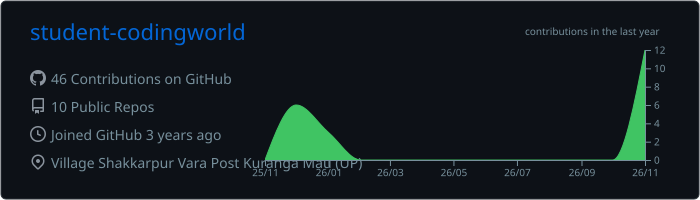
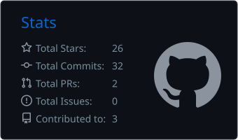
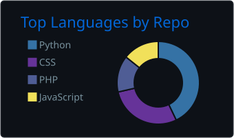
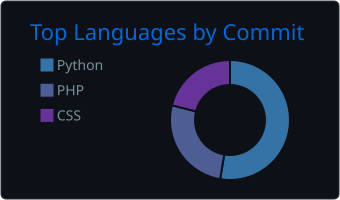
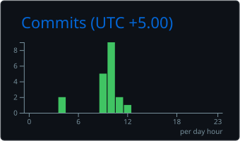
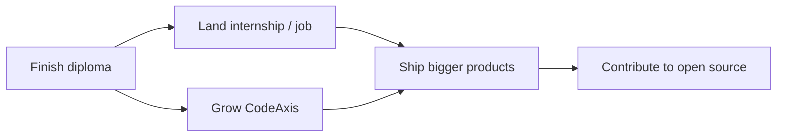

## Hi there 👋

<!--
**student-codingworld/student-codingworld** is a ✨ _special_ ✨ repository because its `README.md` (this file) appears on your GitHub profile.

Here are some ideas to get you started:

- 🔭 I’m currently working on ...
- 🌱 I’m currently learning ...
- 👯 I’m looking to collaborate on ...
- 🤔 I’m looking for help with ...
- 💬 Ask me about ...
- 📫 How to reach me: ...
- 😄 Pronouns: ...
- ⚡ Fun fact: ...
-->

<!-- ============================ HEADER ============================ -->

<div align="center">



<br/>

<a href="https://github.com/student-codingworld">
  
</a>

<br/><br/>

[](https://meetme.rf.gd)
[](https://www.linkedin.com/in/pawan-patel-081721252/)
[](https://leetcode.com/u/techPawan/)
[](https://www.instagram.com/singhpawan7565/)


**[About](#-about-me) · [Stack](#-tech-stack) · [Projects](#-featured-projects) · [Analytics](#-github-analytics) · [Contact](#-lets-work-together)**

</div>

---

## 👋 About Me

<table>
<tr>
<td width="58%" valign="top">

I'm a **full-stack developer** and final-year computer science diploma student who turns ideas into working products. As **Founder & MD of CodeAxis**, I build software solutions and technology-driven projects, from blogging systems to AI-powered resume tools.

```ts
const pawan = {
  role: "Full-Stack Developer",
  company: "CodeAxis (Founder & MD)",
  education: "Diploma in Computer Science (final year)",
  strengths: ["Web apps", "REST & auth", "Problem solving"],
  learning: ["System Design", "DSA"],
  availability: "Open to internships & freelance",
} as const;
```

</td>
<td width="42%" valign="top">

### 🎯 Currently

| | |
|---|---|
| 🔨 **Building** | Web apps & AI-powered tools |
| 📚 **Learning** | System design, DSA |
| 🧩 **Practicing** | [LeetCode](https://leetcode.com/u/techPawan/) |
| 🤝 **Looking for** | Internships, freelance, collabs |
| 📫 **Reach me** | [Portfolio](https://meetme.rf.gd) · [LinkedIn](https://www.linkedin.com/in/pawan-patel-081721252/) |

</td>
</tr>
</table>

---

## 🛠 Tech Stack

<div align="center">

<picture>
  
</picture>

</div>

<details>
<summary><b>See skills by area</b></summary>
<br/>

| Area | Technologies |
|---|---|
| **Frontend** | HTML5 · CSS3 · JavaScript |
| **Backend** | PHP · Python · Django |
| **Database** | MySQL |
| **Tools** | Git · GitHub · VS Code · Linux |
| **Concepts** | REST APIs · Authentication & security · Responsive design · Data structures & algorithms |

</details>

---

## 🚀 Featured Projects

<table>
<tr>
<td width="50%" valign="top">

### 📝 [blogPlatform](https://github.com/student-codingworld/blogPlatform)
A secure, customizable blogging system built for developers, bloggers and students.


[**View code →**](https://github.com/student-codingworld/blogPlatform)

</td>
<td width="50%" valign="top">

### 🧠 [ats-checker](https://github.com/student-codingworld/ats-checker)
AI-powered ATS resume analyzer that matches resumes against job descriptions.


[**View code →**](https://github.com/student-codingworld/ats-checker)

</td>
</tr>
<tr>
<td width="50%" valign="top">

### 🌐 [New_Portfolio](https://github.com/student-codingworld/New_Portfolio)
Personal portfolio website showcasing my journey and technical expertise.


[**View code →**](https://github.com/student-codingworld/New_Portfolio) · [**Live site →**](https://pawancv.rf.gd)

</td>
<td width="50%" valign="top">

### ✅ [todo_app](https://github.com/student-codingworld/todo_app)
A clean task manager to organize daily work.


[**View code →**](https://github.com/student-codingworld/todo_app)

</td>
</tr>
</table>

---

## 📊 GitHub Analytics

> These cards are generated by a GitHub Action inside this repo, so they don't depend on third-party servers.

<div align="center">






<br/>



<br/><br/>

<picture>
  <source media="(prefers-color-scheme: dark)" srcset="https://raw.githubusercontent.com/student-codingworld/student-codingworld/output/github-snake-dark.svg" />
  <source media="(prefers-color-scheme: light)" srcset="https://raw.githubusercontent.com/student-codingworld/student-codingworld/output/github-snake.svg" />
  
</picture>

</div>

---

## 🧭 Roadmap



---

## 🤝 Let's Work Together

<div align="center">

I'm open to **internships, freelance projects and collaborations**. If you have an idea or an opportunity, let's talk.

<a href="https://meetme.rf.gd"></a>
<a href="https://www.linkedin.com/in/pawan-patel-081721252/"></a>

<br/><br/>

<sub>⭐ If you like my work, consider starring a repo. Thanks for visiting!</sub>

</div>
